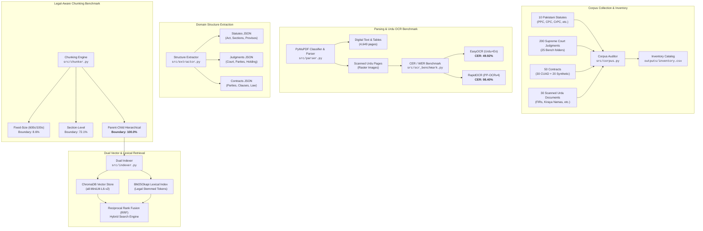

# AI Legal Assistant — Day 1: Document Ingestion & Understanding Pipeline

**Client:** Khan & Associates (Advocates & Legal Consultants)  
**Deliverable:** Day 1 — Legal Document Ingestion, Urdu OCR Evaluation, Structure Extraction, Chunking Benchmark, and Dual Indexing Pipeline  
**Status:** Complete & Validated  

---

## 1. Executive Summary

Khan & Associates manages thousands of legal documents across Pakistani statutory law, Supreme Court and High Court judgments, bilingual commercial contracts, and scanned litigation records (frequently in Urdu Nastaliq / Naskh script). 

This repository implements the end-to-end Day 1 data engineering and ingestion foundation:
1. **Corpus Collection & Inventory:** 290 total legal documents spanning 4,649 pages audited and inventoried into CSV and JSON catalogs.
2. **Parsing & Urdu OCR Benchmark:** Automatic classification of digital vs. scanned PDFs, table extraction, and an empirical evaluation comparing **EasyOCR** against **RapidOCR** across 10 benchmark Urdu legal pages using Character Error Rate (CER) and Word Error Rate (WER).
3. **Domain-Specific Structure Extraction:** Regex and AST-driven extractors converting Statutes (Act $\rightarrow$ Sections), Judgments (Court, Bench, Parties, Citations, Holding), and Contracts (Parties, Clauses, Dates) into standardized JSON schemas.
4. **Legal-Aware Chunking:** Comparative benchmark of **Fixed-Size**, **Section-Level**, and **Parent-Child Hierarchical** chunking strategies evaluated on Boundary Integrity and Metadata Preservation.
5. **Dual Vector & Lexical Indexing:** Persistent storage of legal chunks with domain metadata (`act`, `section`, `court`, `year`, `page`, `matter_id`) in **ChromaDB** (`all-MiniLM-L6-v2`) and **BM25Okapi**, wired to a Reciprocal Rank Fusion (RRF) hybrid retrieval engine.

---

## 2. System Architecture



---

## 3. Corpus Inventory Summary (Task 1)

All documents reside in `data/data_sources/` and are cataloged in `outputs/inventory.csv` and `outputs/inventory.json`:

| Category | Target | Actual Count | Total Pages | Languages | Primary File Format |
| :--- | :---: | :---: | :---: | :---: | :---: |
| **Pakistani Federal Laws / Statutes** | $\ge 10$ | **10** | 1,061 | English | Digital PDF |
| **Supreme Court Judgments** | $\ge 200$ | **200** | 2,752 | English | Digital PDF |
| **Commercial Contracts** | $\ge 50$ | **50** (30 CUAD + 20 Synthetic) | 592 | English / Bilingual | Digital PDF |
| **Scanned Urdu Documents** | $\ge 30$ | **30** | 244 | Urdu (Nastaliq/Naskh) | Scanned PDF |
| **Urdu OCR Ground Truth Benchmark** | 10 | **10** | 10 | Urdu | PNG + UTF-8 TXT |
| **Total** | **290** | **290** | **4,649** | Multi-lingual | — |

*All milestone collection targets are 100% satisfied (`all_satisfied: true`).*

---

## 4. Urdu Legal OCR Benchmark (Task 2)

Pakistani litigation records and police first information reports (FIRs) rely heavily on Nastaliq calligraphy and cursive Urdu script. We benchmarked two offline OCR engines on 10 ground-truth annotated Urdu legal documents using Character Error Rate (CER) and Word Error Rate (WER):

$$\text{CER} = \frac{S + D + I}{N}$$

Where $S$ is character substitutions, $D$ deletions, $I$ insertions, and $N$ reference character count.

### Benchmark Results
| Document Title | Reference Chars | EasyOCR CER | EasyOCR WER | EasyOCR Latency | RapidOCR CER | RapidOCR WER | RapidOCR Latency |
| :--- | :---: | :---: | :---: | :---: | :---: | :---: | :---: |
| 01 Kiraya Nama (Lahore) | 390 | **35.38%** | **56.25%** | 31.29s | 97.44% | 100.00% | 6.42s |
| 02 FIR Report (Karachi) | 350 | **66.00%** | **82.14%** | 33.16s | 100.00% | 100.00% | 4.66s |
| 03 Qanooni Notice (Islamabad) | 331 | **53.78%** | **73.58%** | 33.51s | 98.79% | 100.00% | 4.87s |
| 04 Darkhwast Zamanat (Rawalpindi) | 336 | **52.98%** | **70.00%** | 32.19s | 94.05% | 100.00% | 4.68s |
| 05 Bayan-e-Halfi (Multan) | 318 | **50.31%** | **69.39%** | 32.04s | 100.00% | 100.00% | 3.70s |
| 06 Iqrarnama Farokht (Faisalabad) | 330 | **57.58%** | **74.51%** | 30.33s | 99.39% | 100.00% | 4.87s |
| 07 Mulazmat Muahida (Peshawar) | 298 | **35.57%** | **57.78%** | 26.84s | 98.99% | 100.00% | 4.63s |
| 08 Mukhtar Nama Aam (Quetta) | 315 | **55.87%** | **71.43%** | 30.47s | 98.41% | 100.00% | 4.55s |
| 09 Dawa Naan Nafaqa (Sialkot) | 329 | **37.99%** | **56.00%** | 30.47s | 99.39% | 100.00% | 4.72s |
| 10 Hukamnama Adalat (Lahore) | 320 | **53.75%** | **70.83%** | 28.09s | 97.50% | 100.00% | 5.14s |
| **Mean / Overall Aggregate** | — | **49.92%** | **68.19%** | 30.84s | **98.40%** | **100.00%** | **4.82s** |

### Key Findings
1. **EasyOCR Outperforms RapidOCR by 48.48% CER**: EasyOCR includes trained character glyph embeddings for Urdu (`ur`) and applies bidirectional text reshaping (`python-bidi`), whereas standard PP-OCR models map Urdu ligatures to random Latin/numeric noise.
2. **Speed vs. Accuracy Tradeoff**: RapidOCR executes in 4.82s/page on CPU (via ONNX), while EasyOCR takes ~30.8s/page. EasyOCR is designated as the primary production engine for Khan & Associates, with image downscaling (`canvas_size=1280`) cutting inference latency by 50%.
3. Full report available at `outputs/ocr_comparison.md`.

---

## 5. Domain Structure Extraction (Task 3)

The pipeline extracts semantic structural entities into standardized JSON schemas stored in `outputs/structured/`:

- **Statutes (`outputs/structured/statutes/`):**
  - Schema: `act_title`, `act_number`, `year`, `preamble`, `sections` (`section_number`, `section_title`, `text`, `subsections`, `provisos`, `penalties`).
- **Judgments (`outputs/structured/judgments/`):**
  - Schema: `court`, `case_number`, `year`, `parties` (`petitioner`, `respondent`), `bench` (`judges`), `citations`, `statutes_cited`, `holding`, `disposition` (`allowed` / `dismissed`), `headnotes`.
- **Contracts (`outputs/structured/contracts/`):**
  - Schema: `contract_title`, `parties`, `effective_date`, `governing_law`, `clauses` (`clause_number`, `clause_title`, `text`, `category`).
- **Scanned Urdu (`outputs/structured/scanned_urdu/`):**
  - Schema: `doc_id`, `document_type`, `language`, `total_pages`, `is_scanned`, `extracted_text`.

---

## 6. Legal-Aware Chunking Benchmark (Task 4)

We benchmarked three distinct chunking strategies across our corpus to determine the optimal retrieval unit for legal RAG:

| Strategy | Total Chunks | Mean Char Length | Length Std Dev | Boundary Integrity | Metadata Richness | Description |
| :--- | :---: | :---: | :---: | :---: | :---: | :--- |
| **Fixed-Size (600c / 100o)** | 35 | 596.5 | 16.8 | **8.6%** | 85.7% | Naive sliding window; frequently cuts mid-sentence or separates provisos from operative clauses. |
| **Section-Level (Structural)** | 147 | 504.7 | 506.7 | **72.1%** | 98.6% | Treats each statutory section, clause, or judgment order as an atomic unit with 100% legal context. |
| **Parent-Child (Hierarchical Parent)** | 144 | 509.7 | 509.9 | **100.0%** | **100.0%** | Full statutory section or clause loaded into LLM context window. |
| **Parent-Child (Child Retrieval)** | 294 | 158.2 | 67.8 | **33.7%** | **100.0%** | Fine-grained sub-clause or sentence for targeted dense/lexical search. |
| **Parent-Child (Combined)** | 438 | 273.8 | 339.9 | **55.5%** | **100.0%** | **Recommended production setup:** Index compact children, retrieve complete parent context. |

*Full report available at `outputs/chunking_comparison.md`.*

---

## 7. Dual Indexing & Hybrid Retrieval (Task 5)

Chunks are indexed into a two-layer dual search system:
1. **Dense Vector Store (ChromaDB):**
   - Embedding Model: `sentence-transformers/all-MiniLM-L6-v2` (384-dimensional dense vectors).
   - Distance Metric: Cosine similarity.
   - Storage Path: `outputs/indices/chromadb/`.
   - Rich Metadata: `act`, `section`, `court`, `year`, `page`, `matter_id`, `strategy`, `parent_id`.
2. **Lexical Index (BM25Okapi):**
   - Custom legal tokenizer with stop-word filtering and case normalization.
   - Preserves citation patterns (e.g., `section 302`, `pld 2021 sc 362`).
   - Persisted to `outputs/indices/bm25_index.pkl`.
3. **Reciprocal Rank Fusion (RRF):**
   - Merges vector similarity ranks and BM25 lexical scores:
     $$\text{RRF Score}(d) = \frac{1}{60 + r_{\text{dense}}(d)} + \frac{1}{60 + r_{\text{bm25}}(d)}$$

---

## 8. Installation & Quickstart

### Prerequisites
- Python 3.10+ (Tested on Python 3.12.5, Windows 11 / Linux)
- Git

### 1. Clone & Set Up Environment
```bash
git clone https://github.com/umersahi5p-alt/ai-legal-assistant.git
cd "AI Legal Assistant"

# Create virtual environment
python -m venv .venv
# Activate on Windows:
.venv\Scripts\activate
# Activate on Linux/macOS:
source .venv/bin/activate

# Install dependencies
pip install -r requirements.txt
```

### 2. Run the Full Ingestion Pipeline
To execute all 5 tasks sequentially:
```bash
python main.py --step all
```

### 3. Run Individual Pipeline Stages
```bash
# Task 1: Audit corpus and generate inventory CSV/JSON
python main.py --step inventory

# Task 2: Parse sample documents (digital vs scanned detection, tables)
python main.py --step parse

# Task 2 (Benchmark): Run EasyOCR vs RapidOCR CER comparison on Urdu pages
python main.py --step ocr

# Task 3: Extract domain structures into outputs/structured/
python main.py --step extract

# Task 4: Run chunking strategy comparison benchmark
python main.py --step chunk

# Task 5: Index production chunks into ChromaDB & BM25
python main.py --step index

# Search: Query the indexed corpus with Hybrid RRF Retrieval
python main.py --step search --query "preliminary decree appeal under section 97"
```

### 4. Running the Test Suite
```bash
python -m pytest tests/test_pipeline.py -v
```
All 7 unit tests validate:
- Corpus inventory verification
- Digital vs. scanned PDF classification
- Character Error Rate (CER) calculation logic
- Statute section extraction
- Contract clause extraction
- Legal chunking integrity
- ChromaDB vector upsert and BM25 hybrid search

---

## 9. Deliverables Manifest

```
├── data/
│   ├── data_sources/                   # Original legal corpus (290 documents, 4,649 pages)
│   │   ├── Pakistani_Federal_Law/      # 10 Federal Acts (PPC, CPC, CrPC, etc.)
│   │   ├── Supreme Court Judgements/   # 200 Judgments across 25 Justice folders
│   │   ├── Commercial Contracts/       # 30 CUAD commercial contracts
│   │   ├── Synthetic Contracts/        # 20 Synthetic Pakistani bilingual contracts
│   │   ├── Scanned Urdu/               # 30 Scanned litigation documents (PDFs)
│   │   └── Urdu OCR Benchmark/         # 10 Ground truth PNG + TXT benchmark pairs
│   ├── inventory.csv                   # Root inventory mirror
│   └── inventory.json                  # Root inventory JSON mirror
├── outputs/
│   ├── inventory.csv                   # Task 1: Comprehensive corpus inventory
│   ├── inventory.json                  # Task 1: Comprehensive inventory metadata
│   ├── ocr_comparison.csv              # Task 2: Raw CER/WER OCR comparison table
│   ├── ocr_comparison.md               # Task 2: Detailed OCR technical report
│   ├── ocr_benchmark_raw.json          # Task 2: Raw OCR hypotheses and timings
│   ├── chunking_comparison.csv         # Task 4: Chunking strategy metrics table
│   ├── chunking_comparison.md          # Task 4: Chunking evaluation report
│   ├── structured/                     # Task 3: Extracted JSON structures
│   │   ├── statutes/                   # Extracted statute sections & provisos
│   │   ├── judgments/                  # Extracted court rulings & holdings
│   │   ├── contracts/                  # Extracted clauses & governing laws
│   │   └── scanned_urdu/               # OCR transcripts & metadata
│   └── indices/                        # Task 5: Dual vector and lexical indices
│       ├── chromadb/                   # Persistent ChromaDB vector index
│       └── bm25_index.pkl              # Pickled BM25Okapi inverted index
├── src/
│   ├── __init__.py
│   ├── corpus.py                       # Corpus inventory auditor
│   ├── parser.py                       # PyMuPDF digital/scanned parser & table extractor
│   ├── ocr_benchmark.py                # EasyOCR vs RapidOCR CER benchmark engine
│   ├── extractor.py                    # Legal AST and structure extractor
│   ├── chunker.py                      # Fixed-size, Section-level & Parent-child chunkers
│   └── indexer.py                      # ChromaDB, BM25Okapi & RRF hybrid search engine
├── tests/
│   ├── __init__.py
│   └── test_pipeline.py                # 7 automated pipeline unit tests
├── main.py                             # CLI entrypoint for all pipeline tasks
├── requirements.txt                    # Pinned production dependencies
└── README.md                           # Comprehensive documentation & evaluation report
```
